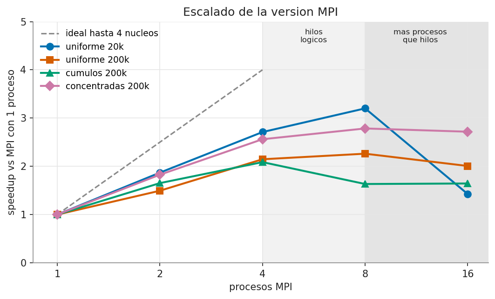
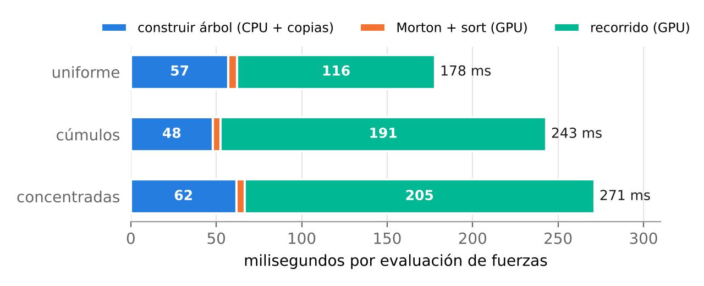

<!--
LÍMITE: 6 páginas. Con Times 12 pt, interlineado 1.15, 3 figuras y 3 tablas
caben ≈ 2 100 palabras en total. Presupuesto por sección en cada comentario.
Medir:  bash tools/exportar_informe.sh   (palabras por sección + páginas del PDF)
El detalle de cada versión queda en el repositorio (informe/seccion_*.md).
-->

## 1. Introducción y diseño común

<!-- Camilo · ≈ 200 palabras -->

Se implementó la simulación de N cuerpos con Barnes-Hut (Barnes y Hut,
1986) en Python con *multiprocessing*, MPI, C con OpenMP y CUDA. Las
cuatro versiones comparten un contrato (`docs/contrato_arbol_plano.md`):

- **Árbol plano en preorden.** Arreglos paralelos sin punteros, que se
  pueden compartir, enviar por MPI o copiar a la GPU tal cual. Cada rama
  es un rango contiguo y se puede saltar entera.
- **Construcción desde el orden Morton** (Morton, 1966; Karras, 2012).
  Al ordenar por un código de 63 bits, las partículas de cada celda
  quedan contiguas y el árbol se arma por prefijos, sin candados.
  Profundidad máxima 20, con varias partículas por hoja en ese nivel.
- **Misma interfaz.** Todas usan *leapfrog* con una evaluación de
  fuerzas por paso, G = 1 y suavizado ε, y reportan tiempos por fase.

La CPU es un i5-8250U (4 núcleos físicos, 8 hilos lógicos, L3 de
6 MiB); la GPU, una T4 de Colab. Se usaron tres distribuciones (semilla
42): **uniforme**, **cúmulos** (dos cúmulos gaussianos en colisión) y
**concentradas** (casi todo en un volumen muy pequeño).

## 2. Verificación de correctitud

<!-- Camilo · ≈ 200 palabras · completar la fila de CUDA (Manuel) -->

`tools/verificar.py` compara las aceleraciones con la suma directa
O(N²) y mide la deriva de la energía. Se exige que ambas sean menores
que 1 % (N = 2000, θ = 0.3, 5 pasos, 4 procesos o hilos).

**Tabla 1.** *Error relativo promedio / máximo frente a la suma directa, y deriva de energía.*

| versión | uniforme | cúmulos | concentradas¹ | deriva máx. |
|---|---|---|---|---|
| Python-mp, C, OpenMP | 0.119 / 1.73 % | 0.110 / 0.84 % | 0.331 / 0.91 % | 0.017 % |
| MPI | 0.119 / 1.73 % | 0.111 / 0.81 % | 0.331 / 0.90 % | 0.017 % |
| CUDA | 0.119 / 1.73 % | 0.110 / 0.84 % | 0.331 / 0.91 % | 0.017 % |

¹ Con dt = 0.00025.

Python, C y OpenMP dan errores **idénticos** porque construyen el mismo
árbol. MPI difiere en la cuarta cifra, porque el LET agrupa algunas
celdas remotas de otra forma.

La deriva depende de dt, no de θ. Con dt = 0.001, la distribución
concentrada deriva 6.75 %, y la suma directa, con fuerzas exactas,
deriva aún más (7.06 %). La causa son los encuentros cercanos. Con
dt = 0.00025 la deriva baja a 0.017 %.

## 3. Python con multiprocessing

<!-- Camilo · ≈ 220 palabras · detalle: informe/seccion_python.md -->

El árbol se construye con NumPy y el recorrido se vectoriza por lotes:
cada iteración evalúa a la vez todos los pares (partícula, nodo)
pendientes. La dificultad es **compartir el árbol entre procesos**. Se
midieron dos estrategias sobre `shared_memory`:

- **compartido**: un proceso construye el árbol y los demás lo leen;
- **local**: cada trabajador reconstruye su propia copia.

Con el árbol construido por Morton (0.07 s), ambas quedan a menos de 2 %.
**Se eligió compartido** porque el *build* de la local crece con P
(0.09 → 0.41 s de 2 a 8 procesos), porque la local guarda P copias del
árbol (≈ 240 MB con 8 procesos y N = 200 000) y porque es el mismo
esquema de MPI. Con el árbol anterior, que se construía insertando
partícula por partícula, la local era más lenta que la secuencial: la
decisión se volvió a medir cuando cambió el árbol.

El *speedup* se estanca en ≈ 1.7×, y no por la fracción secuencial
(0.3 %). Cada trabajador está balanceado y sin esperas, pero el
rendimiento total se satura en ≈ 4 900 partículas por segundo desde 2
procesos. Los arreglos temporales del recorrido vectorizado saturan el
**ancho de banda de memoria**.

## 4. MPI

<!-- Camilo · ≈ 330 palabras · detalle: informe/seccion_mpi.md -->

Ningún proceso tiene el árbol global. En cada evaluación de fuerzas,
cada proceso hace cuatro cosas:

1. Ordena las claves Morton, corta la curva en P tramos de igual peso
   y redistribuye las partículas con `MPI_Alltoallv`.
2. Construye su árbol local con el código del núcleo C.
3. Para cada destino, recorre su árbol en preorden. Envía como un solo
   nodo cada celda que está lejos de la región del destino y salta su
   rama (`i = fin[i] + 1`). Esto forma el LET (*Locally Essential
   Tree*; Warren y Salmon, 1993), que viaja en un solo `MPI_Alltoallv`.
4. Recorre su árbol y los P − 1 LET recibidos.

Tres decisiones se midieron con 200 000 partículas concentradas y P = 4:

- **Morton frente a bisección en x:** 7.3 s frente a 14.3 s. La
  bisección hace 24 % más interacciones porque las rebanadas tienen más
  frontera.
- **64 cajas por destino en lugar de 1:** con una sola caja, cada
  proceso recibía casi el árbol global; con 64 recibe el 45 %.
- **Recorrer en orden Morton:** 29.8 s → 14.3 s, por localidad de caché.

En total, ningún proceso tiene más del 65 % del árbol. El balance por
costo no mejoró el tiempo más allá del ruido térmico, que llega a 25 %.

**Caso cúmulos.** Con P = 2 el corte separa los dos cúmulos y el LET es
pequeño. Con P ≥ 4 los cortes caen dentro de los cúmulos y los dividen
en un bloque denso y capas que lo envuelven, que necesitan el bloque
con todo detalle. Las partículas ajenas vecinas de cada proceso
(`tools/vecinos_corte.py`) crecen como el LET: de 100 a 25 000 y a
42 000, frente a 7 800, 75 000 y 112 000 nodos. En la uniforme, ese
conteo se mantiene estable.

{width=62%}

## 5. C con OpenMP

<!-- MANUEL · ≈ 280 palabras, SIN figura (la comparación ya muestra OpenMP).
Sugerido:
- construcción paralela del árbol desde Morton, idéntica byte a byte al
  secuencial (prueba_arbol_omp), sin candados;
- recorrido con schedule(dynamic,64) frente a static. Medido en el
  i5-8250U (walk, N = 200 000, mínimo de 5 corridas alternadas): dynamic
  gana 3 / 12 % en uniforme (4 / 8 hilos), 11 / 23 % en cúmulos y
  17 / 20 % en concentradas. (El 35 % era del i5-12500H: no usar.)
- ordenar_por_morton sin variable global.
El porqué del aplanamiento va en la sección 7: aquí solo apuntar a ella.
-->

Todos los hilos comparten el mismo árbol y las mismas partículas. Se
paralelizan la caja envolvente (reducción `min`/`max`), los códigos
Morton y la integración. Solo el ordenamiento (`qsort`) es secuencial;
para que fuera seguro con hilos, `ordenar_por_morton` dejó de usar una
variable global.

**Construcción del árbol sin candados.** Un hilo arma el esqueleto (los
niveles superiores) y se detiene cuando un nodo tiene menos de
N/(8·hilos) partículas. Cada uno de esos rangos Morton es una tarea: un
subárbol independiente que un hilo construye en un árbol local, con
`schedule(dynamic, 1)`. Como los rangos no se tocan, ningún hilo escribe
donde escribe otro. Luego, una suma prefija en preorden da la posición
de cada subárbol en el árbol final, se copian en paralelo sumando ese
desplazamiento a `hijos[]`, y los nodos del esqueleto se llenan de atrás
hacia adelante. El resultado es **idéntico byte a byte** al árbol
secuencial (`prueba_arbol_omp`, en las tres distribuciones).

**Recorrido balanceado.** Cada hilo escribe solo la aceleración de sus
partículas, así que no hay condición de carrera. Las partículas se
recorren en orden Morton y se reparten con `schedule(dynamic, 64)`: una
partícula en una zona densa abre muchos más nodos que una aislada, y con
un reparto estático el hilo que recibe un cúmulo termina de último. El
reparto se cambia sin recompilar con `OMP_SCHEDULE`.

Con N = 200 000 y 8 hilos, el recorrido ocupa ≈ 95 % del tiempo y el
árbol menos de 0.06 s, así que el escalado lo decide el recorrido,
limitado por la memoria (sección 7).

## 6. CUDA

<!-- MANUEL · ≈ 370 palabras + figura pequeña (width≈60%) de desglose por fase.
Sugerido:
- árbol aplanado (6 arreglos), Morton y sort en GPU con Thrust;
- recorrido sin recursión con pila explícita, 1 hilo por partícula en orden
  Morton: los 32 hilos de un warp abren casi los mismos nodos;
- cudaEvent por fase; el build en CPU (≈ 24 % del total) es la fracción
  secuencial; separar copias CPU<->GPU;
- compute-sanitizer memcheck/racecheck: 0 errores;
- barrido de hilos por bloque (tools/comparar_cuda.py --hilos 32 64 128 256).
-->

El árbol plano del contrato (seis arreglos: centro, lado, masa, centro
de masa, hijos y partícula) se copia a la GPU como estructura de
arreglos, para que los accesos de un warp sean contiguos. Cada
evaluación de fuerzas tiene tres fases, medidas con `cudaEvent`:

1. **Morton y ordenamiento en la GPU.** Un hilo por partícula calcula
   su código y `thrust::sort_by_key` las ordena (radix sort estable,
   con el mismo desempate que el núcleo C).
2. **Construcción del árbol en la CPU.** Se copian el orden y los
   códigos a la CPU, se construye el árbol con el núcleo C y se copian
   los seis arreglos a la GPU. El tiempo incluye esas copias.
3. **Recorrido sin recursión.** Cada hilo calcula una partícula con una
   pila explícita en registros, en orden Morton. Así, los 32 hilos de un
   warp son partículas vecinas que abren casi los mismos nodos, lo que
   reduce la divergencia.

La integración *leapfrog* también corre en la GPU y tarda menos de
1 ms. `compute-sanitizer` (memcheck y racecheck) no reportó errores, y
la versión pasa la verificación con los mismos errores que C (Tabla 1).

{width=60%}

Con N = 200 000, una evaluación tarda entre 0.18 y 0.27 s, entre 6 y 8
veces menos que la mejor versión en CPU. El recorrido es lo que más
cuesta y crece en las distribuciones densas (116 ms en la uniforme
frente a 205 ms en las concentradas), porque una partícula en un cúmulo
abre más nodos y los warps hacen más trabajo. La construcción en la CPU
ocupa entre el 20 y el 32 % del tiempo: es la **fracción secuencial**
de esta versión y la que limitaría el *speedup* si el recorrido fuera
aún más rápido. El ordenamiento en la GPU es despreciable (≈ 5 ms).

El tamaño de bloque cambia poco el resultado: con 32, 64, 128 y 256
hilos por bloque los tiempos difieren como mucho 11 %, y 32 fue
ligeramente más rápido en el recorrido (`tools/comparar_cuda.py`).

## 7. Comparación y análisis del escalado

<!-- Camilo · ≈ 380 palabras · detalle: informe/seccion_comparacion.md -->

**Tabla 2.** *Segundos por evaluación de fuerzas, N = 200 000 (mediana de 3; entre paréntesis, procesos o hilos).*

| versión | uniforme | cúmulos | concentradas |
|---|---|---|---|
| Python-mp (8) | 16.5 | 26.1 | 27.9 |
| C secuencial | 6.21 | 8.89 | 10.53 |
| OpenMP (1) | 2.74 | 6.17 | 6.63 |
| OpenMP, mejor | 1.25 (8) | **1.99** (8) | 2.40 (8) |
| MPI, mejor | **1.10** (8) | 2.46 (4) | **2.28** (4) |
| CUDA (T4, 128 hilos/bloque) | **0.18** | **0.24** | **0.27** |

**El orden del recorrido importa más que un núcleo extra.** Con un solo
hilo, OpenMP y MPI son entre 1.2× y 2.3× más rápidos que el C
secuencial, con el mismo árbol. La razón es que recorren las partículas
en orden Morton: partículas consecutivas abren los mismos nodos, que
siguen en caché. Por el mismo motivo, en la GPU cada warp recibe 32
partículas vecinas.

**De 1 a 4 núcleos físicos** se llega a 2.1–3.0×. La distancia al ideal
no la explican la fracción secuencial (< 2 %), el desbalance (≤ 1.06)
ni la comunicación de MPI (≈ 6 %). La explica la **memoria**: con
200 000 partículas el árbol (≈ 30 MB) no cabe en la L3. Con 20 000, cuyo
árbol ocupa ≈ 3 MB, MPI llega a 2.7× en lugar de 2.1×. Además, la
frecuencia baja cuando los cuatro núcleos están cargados.

**De 4 a 8 hilos lógicos** la ganancia es pequeña o negativa:

- mejora un 18 % OpenMP en cúmulos y un 7 % MPI en uniforme;
- empeora MPI en cúmulos (crece el LET) y en concentradas.

Dos hilos del mismo núcleo comparten las unidades de cálculo y las
cachés L1/L2.

**Con más procesos que hilos** (MPI, P = 16), el tiempo empeora en las
tres distribuciones. Cada colectiva espera al proceso que el sistema
operativo dejó fuera, y la comunicación llega al 15–19 % del tiempo,
y al 50 % con N = 20 000.

**Python** es entre 8.5 y 15 veces más lento que OpenMP o MPI con 8
procesos y N = 200 000, y hasta 25 veces con N = 20 000. **CUDA** es
entre 6 y 8 veces más rápida que la mejor CPU, y su fracción secuencial es el
*build* en la CPU.

## 8. Conclusiones

<!-- Camilo y Manuel · ≈ 150 palabras -->

- Un árbol común (plano, en preorden y construido desde Morton) hizo
  que las cuatro versiones fueran verificables contra la misma
  referencia.
- En esta máquina el escalado lo limita la **memoria**, no la fracción
  secuencial. Por eso la localidad dio más que pasar de 4 a 8 hilos.
- **OpenMP** es la opción más robusta en una sola máquina. **MPI** es la
  única que reparte la memoria, pero sufre cuando los cortes caen en
  zonas densas. **CUDA** es entre 6 y 8 veces más rápida con N grande.
- Conviene usar tantos procesos como núcleos físicos.

Código, historial, scripts y CSV: repositorio `JuanCamilo1611/Barnes-Hut`.

## Referencias

Barnes, J., y Hut, P. (1986). A hierarchical O(N log N) force-calculation
algorithm. *Nature, 324*(6096), 446–449. https://doi.org/10.1038/324446a0

Burtscher, M., y Pingali, K. (2011). An efficient CUDA implementation of
the tree-based Barnes Hut n-body algorithm. En W. W. Hwu (Ed.), *GPU
Computing Gems Emerald Edition* (pp. 75–92). Morgan Kaufmann.

Karras, T. (2012). Maximizing parallelism in the construction of BVHs,
octrees, and k-d trees. En *Proceedings of the Fourth ACM SIGGRAPH /
Eurographics Conference on High-Performance Graphics* (pp. 33–37).

Morton, G. M. (1966). *A computer oriented geodetic data base and a new
technique in file sequencing*. IBM.

Warren, M. S., y Salmon, J. K. (1993). A parallel hashed oct-tree N-body
algorithm. En *Proceedings of Supercomputing '93* (pp. 12–21). ACM.
