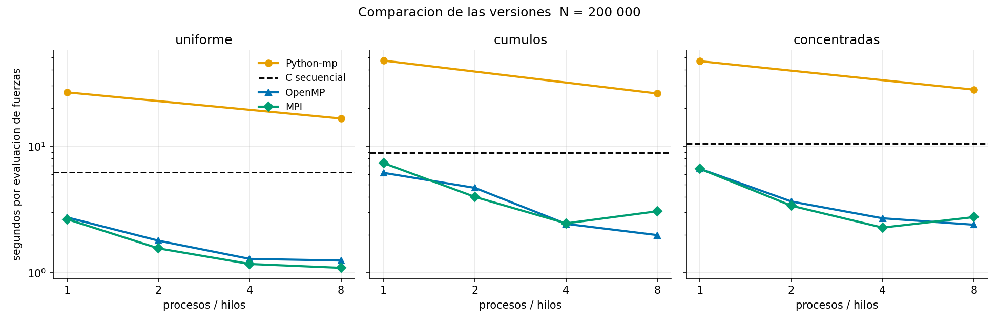

# Comparación de las versiones

Las cuatro versiones en CPU se midieron con los mismos datos (semilla
42), los mismos parámetros (θ = 0.5, ε = 0.01, dt = 0.001, 1 paso) y la
misma máquina (i5-8250U, 4 núcleos y 8 hilos). Se usó
`tools/comparar.py`, que reporta la mediana de 3 repeticiones; Python
con N = 200 000 tiene 1 sola repetición. La métrica es el **tiempo por
evaluación de fuerzas**, porque todas las versiones calculan las fuerzas
una vez al inicio y una vez por paso. Los CSV están en
`resultados/comparar_20261126_1104.csv`.

Segundos por evaluación de fuerzas con N = 200 000, comparando una sola
unidad de cómputo con la mejor configuración:

| versión | uniforme | cúmulos | concentradas |
|---|---|---|---|
| Python-mp, 1 proceso | 26.6 | 47.4 | 46.9 |
| Python-mp, 8 procesos | 16.5 | 26.1 | 27.9 |
| C secuencial | 6.21 | 8.89 | 10.53 |
| OpenMP, 1 hilo | 2.74 | 6.17 | 6.63 |
| OpenMP, mejor (hilos) | 1.25 (8) | **1.99** (8) | 2.40 (8) |
| MPI, 1 proceso | 2.65 | 7.36 | 6.63 |
| MPI, mejor (procesos) | **1.10** (8) | 2.46 (4) | **2.28** (4) |
| CUDA, T4 (preliminar, 1 rep.) | **0.20** | — | **0.31** |

*Speedup* de cada versión contra sí misma con 1 proceso o hilo
(N = 200 000; Python con N = 20 000):

| versión | P = 2 | P = 4 | P = 8 |
|---|---|---|---|
| Python-mp | 1.42–1.53× | 1.66–1.70× | 1.57–1.66× |
| OpenMP | 1.31–1.81× | 2.12–2.53× | 2.19–3.10× |
| MPI | 1.70–1.95× | 2.25–2.99× | 2.40–2.42× |

## Lo que muestran

**1. El orden del recorrido pesa más que un núcleo extra.** OpenMP y MPI
con un solo hilo son entre 1.2× y 2.3× más rápidos que el C secuencial,
aunque usan el mismo árbol y el mismo criterio θ. La diferencia es que
recorren las partículas en orden Morton: partículas consecutivas abren
casi los mismos nodos, y esos nodos siguen en caché. El secuencial las
recorre en el orden del archivo y salta por todo el árbol. La GPU usa
el mismo principio: en un warp hay 32 partículas vecinas, que siguen
casi el mismo camino y divergen poco.

**2. OpenMP y MPI quedan parejos en una sola máquina**, cada uno con
ventaja en un caso distinto:
- **Uniforme:** gana MPI (1.10 s frente a 1.25 s). Cada proceso tiene un
  árbol propio más pequeño, con mejor localidad, y su LET es chico.
- **Cúmulos con 8:** gana OpenMP (1.99 s frente a 3.07 s). Los hilos
  comparten un único árbol, sin reparto ni LET. En MPI, en cambio, el
  LET crece al cortar los cúmulos (ver la sección de MPI).
- **Ninguna de las dos escala más allá de 4.** Los hilos lógicos aportan
  poco cuando el recorrido está limitado por la memoria (2.2–3.1× con 8
  frente a 4 núcleos físicos).

**3. Python-mp es entre 8 y 16 veces más lento que OpenMP o MPI** con la
misma cantidad de procesos, y se estanca en ≈ 1.7×. El árbol es el
mismo, pero cada nivel del recorrido vectorizado crea arreglos
temporales en memoria, y desde 2 procesos el rendimiento total se
satura en el ancho de banda (sección de Python).

**4. La GPU es otro orden de magnitud.** Con N = 200 000 uniforme, una
evaluación tarda 0.20 s en la T4, frente a 1.10 s del mejor resultado en
CPU (≈ 5.5×). De ese tiempo, el 24 % es construir el árbol, que se hace
en la CPU. Esa es la fracción secuencial que limita a la GPU.

**5. Recomendación por caso:**
- distribución desconocida y una sola máquina: **OpenMP**, porque es
  robusto ante cúmulos;
- datos que no caben en un nodo: **MPI**, que es el único que reparte
  la memoria;
- muchas evaluaciones de N grande: **CUDA**.

En todos los casos conviene usar tantos procesos o hilos como núcleos
físicos (4); con más, la ganancia es poca o el tiempo empeora.
