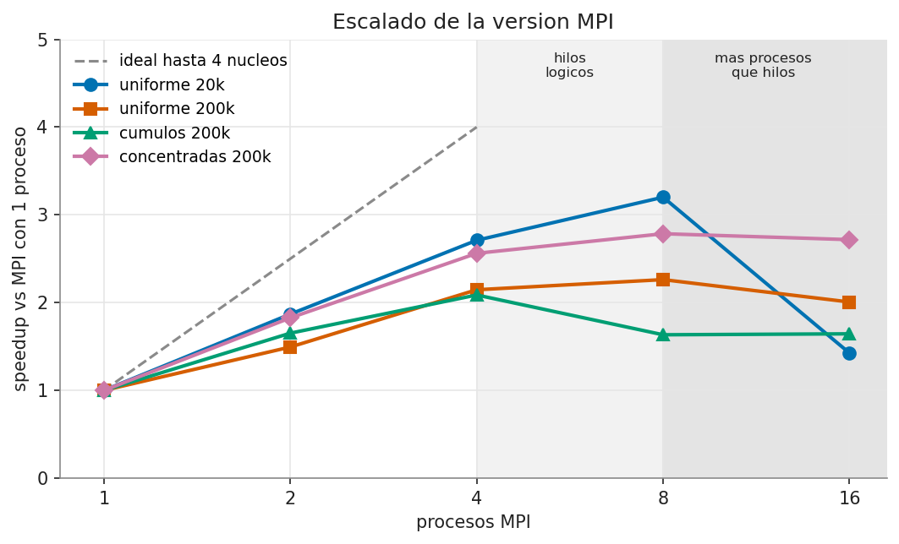
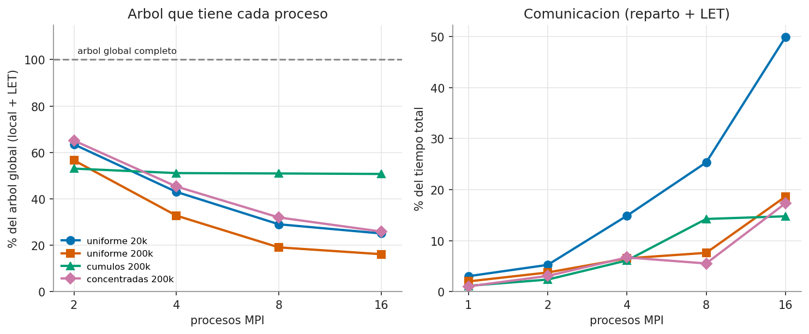

# Versión MPI

## Diseño

La versión MPI (`c/mpi/`) reutiliza el núcleo C (Morton, árbol plano en
preorden y recorrido) y le agrega tres piezas. **Ningún proceso construye
ni recibe el árbol global**. En cada cálculo de fuerzas, cada proceso hace
lo siguiente:

1. **Reparto** (`reparto.c`). Calcula el cubo raíz común con
   `MPI_Allreduce`, asigna una *clave* de 64 bits a cada partícula, ordena
   las claves y las corta en P tramos de igual **peso**. Los cortes salen
   de cuantiles sobre muestras reunidas con `MPI_Allgatherv`, y las
   partículas migran a su dueño con `MPI_Alltoallv`. La clave es el código
   **Morton** (cada proceso recibe un tramo de la curva Z, que es una
   región compacta) o la coordenada x (**bisección** en rebanadas). El
   peso es el costo medido en el paso anterior (interacciones del
   recorrido) o 1 por partícula. Ambas opciones se eligen sin recompilar
   (`BH_PARTICION`, `BH_BALANCE`), y una estrategia nueva se agrega en la
   función `clave_particula()`.
2. **Árbol local.** Cada proceso ordena por Morton *sus* partículas y
   construye con el núcleo C un árbol solo con ellas.
3. **LET** (*Locally Essential Tree*, `let.c`). Cada proceso describe su
   región con hasta 64 cajas ajustadas: las cajas de partículas de los
   nodos altos de su árbol local. Para cada destino, recorre su árbol en
   preorden y compara cada celda con las cajas del destino:
   - si la celda está lejos de todas las cajas (lado < θ · distancia), se
     envía como un solo nodo resumido y se salta su rama entera con
     `i = fin[i] + 1`, porque en preorden cada rama es un rango contiguo;
   - si no, se envía el nodo y se siguen sus hijos.

   Todos los LET viajan en un solo `MPI_Alltoallv`, y cada uno llega como
   un árbol plano del contrato más pequeño.
4. **Recorrido** sobre el árbol local y los P − 1 LET recibidos, con el
   mismo criterio de apertura del núcleo, en **orden Morton local**. La
   integración es *leapfrog* con una sola evaluación de fuerzas por paso.

## Correctitud

Se usó `tools/verificar.py` con N = 2000, θ = 0.3, 5 pasos y dt = 0.001,
frente a la suma directa O(N²):

| distribución | procesos | error promedio | deriva de energía |
|---|---|---|---|
| uniforme | 1, 2, 4, 8 | 0.118–0.119 % | 0.000000 % |
| cúmulos | 1, 2, 4, 8 | 0.110–0.111 % | ≤ 0.0001 % |
| concentradas (dt = 0.00025) | 1, 4, 8 | 0.329–0.331 % | 0.017 % |

Con P = 1 las aceleraciones son idénticas a las del C secuencial, y el
error casi no cambia con P: el LET resume celdas con el mismo criterio θ
que el árbol completo.

En concentradas, con dt = 0.001 la energía deriva un 6.75 %, exactamente
lo mismo que el C secuencial y menos que la suma directa (7.06 %). La
deriva se debe a encuentros cercanos que el paso de tiempo no resuelve,
no a Barnes-Hut ni a MPI. Por eso esa distribución se verifica con
dt = 0.00025.

## Mediciones

Las mediciones se hicieron con `tools/medir.py`: mediana de 3
repeticiones, 3 pasos y θ = 0.5, en un Intel i5-8250U de **4 núcleos
físicos y 8 hilos lógicos** con 6 MiB de L3. La colocación de los
procesos depende de P:

- P ≤ 4: un proceso por núcleo físico;
- P = 8: un proceso por hilo lógico (`--use-hwthread-cpus`);
- P = 16: `--oversubscribe --bind-to none`.

El *speedup* se mide contra MPI con P = 1, es decir, el mismo código.
Con 200 000 partículas:

| distribución | P = 1 (s) | P = 2 | P = 4 | P = 8 | P = 16 |
|---|---|---|---|---|---|
| uniforme | 8.08 | 1.49× | 2.15× | 2.26× | 2.01× |
| cúmulos | 14.32 | 1.65× | 2.09× | 1.63× | 1.64× |
| concentradas | 20.42 | 1.83× | 2.56× | 2.79× | 2.72× |
| uniforme, N = 20 000 | 0.62 | 1.87× | 2.71× | 3.20× | 1.43× |

**El LET no replica el árbol.** La figura siguiente muestra qué fracción
del árbol global tiene cada proceso (árbol local más LET recibidos):

- con 4 procesos, entre el 33 % y el 51 %;
- con 8 procesos, entre el 19 % y el 51 %;
- nunca más del 65 %.

El trabajo tampoco aumenta: las interacciones por partícula pasan de
678 a 685 en la distribución uniforme de P = 1 a P = 8, y de 1127 a
1134 en cúmulos.

## Decisiones de diseño medidas

- **Morton frente a bisección.** Con 200 000 partículas concentradas y
  P = 4, el recorrido tarda 7.3 s con Morton y 14.3 s con bisección.
  Las rebanadas tienen más superficie de frontera con sus vecinas, así
  que abren más celdas remotas: 1555 interacciones por partícula frente
  a 1251 (+24 %).
- **Región con 64 cajas en lugar de 1.** Un tramo Morton puede quedar
  disperso por el dominio. Con una sola caja envolvente, cada destino
  parecía cubrir casi todo el cubo y recibía unos 222 000 nodos de LET.
  Sumados a sus 76 000 locales, eso es prácticamente el árbol global de
  297 000 nodos (concentradas, P = 4). Con 64 cajas ajustadas, el total
  baja al 45 %.
- **Recorrer en orden Morton.** Las partículas llegan del reparto en
  orden de clave. Con bisección ese orden es por x, y recorrer así visita
  nodos dispersos: 29.8 s, frente a 14.3 s en orden Morton. Por la misma
  localidad de caché, MPI con P = 1 es entre 1.6× y 2.6× más rápido que
  el C secuencial, que recorre en el orden del archivo. Por eso el
  *speedup* se reporta contra MPI con P = 1 y no contra ese secuencial.
- **Balance por costo.** Se midió con cúmulos, 200 000 partículas y 3
  repeticiones, comparando el peso por costo con el peso por partícula:

  | P | desbalance (costo) | desbalance (partículas) | tiempo (costo) | tiempo (partículas) |
  |---|---|---|---|---|
  | 4 | 1.07 | 1.08 | 8.0 s | 10.2 s |
  | 8 | 1.13 | 1.16 | 11.3 s | 10.8 s |

  El desbalance (máximo / promedio del tiempo de recorrido) apenas
  cambia, y la diferencia de tiempo está dentro del ruido: la misma
  configuración varió entre 6.0 y 10.0 s por la temperatura del
  portátil. Con Morton y pesos iguales el reparto ya es bueno. El
  desbalance que queda viene sobre todo del hardware (dos procesos en un
  mismo núcleo con P = 8), y los pesos del paso anterior no lo pueden
  corregir. Se deja el costo como opción por defecto porque no empeora y
  protege ante distribuciones más extremas.

## Por qué el escalado se aplana

**De 1 a 4 procesos (núcleos físicos)** el *speedup* llega a 2.1–2.6×
con 200 000 partículas, y a 2.7× con 20 000. No lo limita la fracción
secuencial: árbol, ordenamiento e integración son menos del 2 % del
tiempo con P = 1, y además también se reparten entre los procesos. Ni el
desbalance (≤ 1.06) ni la comunicación (≈ 6 % del tiempo) explican la
distancia al ideal de 4×.

Lo que sí la explica es la **memoria**. El recorrido lee el árbol de
forma irregular, y con 200 000 partículas el árbol de cada proceso no
cabe en la L3 compartida de 6 MiB. Con 20 000 partículas el árbol global
ocupa ≈ 3 MB y el escalado es mejor (2.7× frente a 2.1× con P = 4).
Además, el portátil baja su frecuencia cuando los cuatro núcleos están
cargados.

**De 4 a 8 procesos (hilos lógicos)** casi no hay ganancia: uniforme
pasa de 2.15× a 2.26× y concentradas de 2.56× a 2.79×. Los 8 procesos
comparten los 4 núcleos y sus mismas unidades de cálculo y caché L1/L2,
y el hyperthreading solo aprovecha los ciclos que un hilo deja libres
esperando memoria. En cúmulos el tiempo incluso empeora (1.63×), aunque
el número de interacciones no cambia. Hay tres señales:

- el tiempo de reparto pasa de 0.33 a 1.05 s;
- el desbalance sube a 1.14;
- la fracción del árbol que tiene cada proceso se queda en ≈ 51 % desde
  P = 2: el LET recibido crece (75 000 → 112 000 nodos) a medida que el
  árbol local se achica.

Nuestra hipótesis es que los cortes de la curva Morton parten los
cúmulos densos, y cada mitad necesita la otra con todo detalle porque
está a menos de θ de distancia. Ese recorrido sobre árboles remotos tiene
peor localidad que sobre el propio.

**Con más procesos que hilos (P = 16)** el rendimiento empeora en todos
los casos, porque el sistema operativo turna 16 procesos en 8 hilos. Las
colectivas (`Allreduce`, `Alltoallv`) esperan al proceso más lento, y
basta que uno esté desalojado para que todos esperen. La comunicación
sube al 15–19 % del tiempo con 200 000 partículas y al 50 % con 20 000,
donde hay tan poco cómputo por proceso que el costo fijo de
sincronizarse domina. Por eso el pico está en P = 4 (cúmulos) o P = 8
(uniforme y concentradas), y no tiene sentido usar más procesos que
hilos de hardware.
