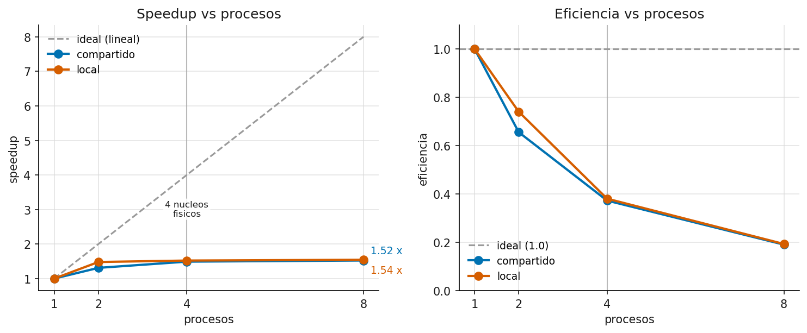
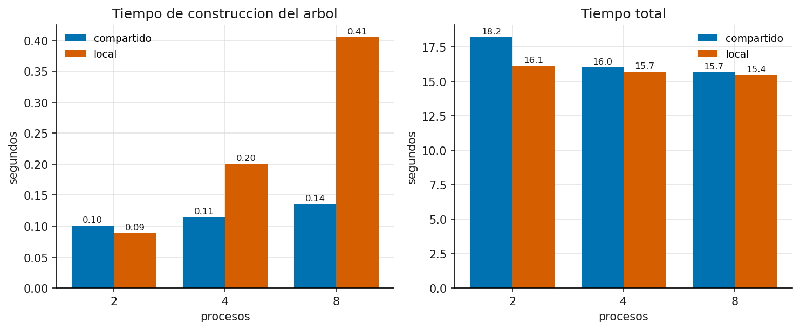

# Versión Python con multiprocessing

## Diseño

El octree se representa con un **árbol plano** (*struct-of-arrays*): los
nodos se guardan en arreglos NumPy paralelos (`centro`, `lado`, `masa`,
`com`, `hijos[8]`, `part`) en lugar de objetos enlazados, de modo que la
misma estructura se comparte entre procesos y es idéntica a la que usan las
versiones en C y CUDA. El recorrido se vectoriza por lotes de partículas y
no usa recursión: cada iteración evalúa toda la frontera (partícula, nodo)
con operaciones de NumPy, por lo que el número de iteraciones es la
profundidad del árbol. La integración es *leapfrog* KDK con una sola
evaluación de fuerzas por paso.

La dificultad de la versión Python es **cómo compartir el árbol entre
procesos**. Se implementaron y midieron dos estrategias sobre
`multiprocessing.shared_memory`:

- **compartido**: el proceso principal construye el árbol una vez en
  bloques de memoria compartida y los trabajadores solo lo recorren;
- **local**: cada trabajador reconstruye su propio árbol a partir de las
  posiciones (también en memoria compartida).

## Correctitud

Ambas estrategias se validan con la suma directa O(N²) mediante
`tools/verificar.py`. Con N=1000 y θ=0.3, el **error relativo promedio de
las fuerzas es 0.12 %** (máximo 0.92 %), por debajo del 1 % admisible para
ese θ, y la **energía mecánica se conserva** (deriva 0.000 %). Las
estrategias secuencial, compartido y local producen **resultados
idénticos**, lo que confirma que la paralelización no altera el cálculo.

## Mediciones y decisión

Se midió el escalado con 1, 2, 4 y 8 procesos (mediana de 3 repeticiones)
sobre una distribución uniforme de N=20000 partículas, en un Intel
i5-8250U de **4 núcleos físicos / 8 hilos lógicos**.

| estrategia | procesos | build (s) | walk (s) | total (s) | speedup | eficiencia |
|---|---|---|---|---|---|---|
| secuencial | 1 | 2.47 | 23.79 | 26.25 | 1.00 | 1.00 |
| compartido | 2 | 2.80 | 16.97 | 19.84 | 1.32 | 0.66 |
| **compartido** | **4** | 2.85 | 15.53 | **18.44** | **1.42** | 0.36 |
| compartido | 8 | 3.90 | 17.23 | 20.92 | 1.25 | 0.16 |
| local | 2 | 3.29 | 16.48 | 19.85 | 1.32 | 0.66 |
| local | 4 | 5.64 | 16.68 | 22.16 | 1.18 | 0.30 |
| local | 8 | 11.19 | 15.55 | 27.97 | 0.94 | 0.12 |

**Se elige la estrategia `compartido`.** Construye el árbol una sola vez y
obtiene el mejor tiempo total (18.44 s con 4 procesos, *speedup* 1.42×).
La estrategia `local` se descarta: reconstruir el árbol en cada trabajador
es trabajo redundante O(P·N log N) cuyo coste de construcción se dispara
(hasta 11.2 s con 8 procesos) y la vuelve **más lenta que la versión
secuencial** (*speedup* 0.94×). Su único beneficio teórico —mejor localidad
de caché en el recorrido— no se materializa, porque el cuello de botella es
el ancho de banda de memoria, no la localidad (los tiempos de *walk* de
ambas estrategias son casi iguales).

## Por qué el escalado se aplana

El punto óptimo son **4 procesos**, coincidiendo con los núcleos físicos, y
el *speedup* máximo es modesto (1.42×). Tres causas, en orden de impacto:

1. **El recorrido está limitado por el ancho de banda de memoria.** El
   *walk* solo escala 1.53× con 4 núcleos (23.79 → 15.53 s): es un acceso
   aleatorio tipo *pointer-chasing* sobre un árbol de varios MB que desborda
   la caché L3 de 6 MB; cuatro núcleos comparten un único controlador de
   memoria y lo saturan. La fracción secuencial del *build* es solo ≈9 %,
   de modo que la ley de Amdahl permitiría hasta ≈3.1× si el recorrido
   escalara de forma ideal: el límite real es la memoria, no la parte
   serial.
2. **Solo hay 4 núcleos físicos.** Al pasar de 4 a 8 procesos no hay
   ganancia (incluso se pierde), porque los 8 hilos son lógicos
   (*hyperthreading*) y comparten los puertos de memoria del mismo núcleo,
   que ya está saturado.
3. **Fracción secuencial (Amdahl).** La construcción del árbol y la
   integración no se paralelizan en `compartido`; en `local`, además, el
   coste de reconstrucción redundante crece con el número de procesos y es
   la causa de su derrota.
